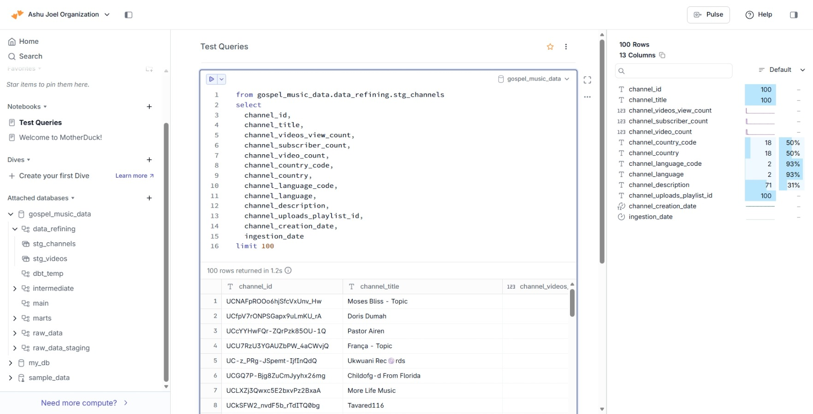
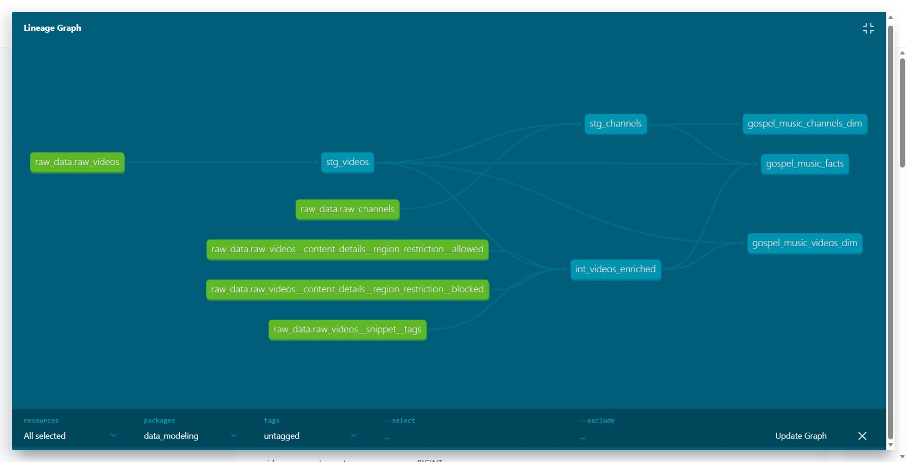
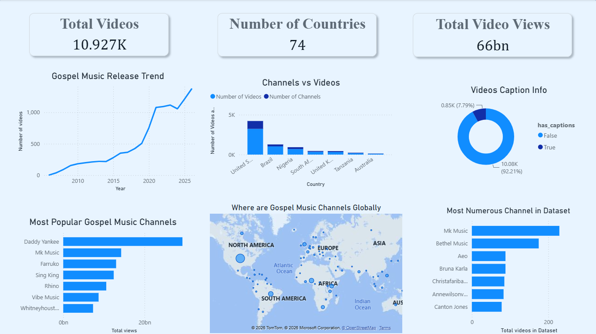

#  **GOSPEL MUSIC DATA PIPELINE**

## Introduction
An **ELT** pipeline designed to **extract** gospel music data (channels and  videos data) from Youtube , **loads** it to a cloud data warehouse, **transforms** it (e.g renaming columns, redifinig data types, null handling . . .) to **build insightful dashboards**.

##  Working Environment / Tools:
- ** Code Editor:**  VS Code (Visual Studio Code Editor)
- ** Terminal**:  Ubuntu (WSL2)
- ** Data Extraction Tool (E):**  Python 
- ** Data Ingestion Tool (L):**  DLT (Data load Tool)
-  ** Cloud Warehouse:**  Motherduck (Duckdb in the cloud)
- ** Data Transformation and Testing (T)**:  DBT (Data Build Tool)
- ** Version Control:**  Git /  Github 
- ** Dashboard:**   Power BI (Microsoft Business Intelligence Tool)

## Project Scope
This Project was built primarily to showcase my skills as a Data Engineer. I noticed it is a **rare** niche in public datasets and data bootcamps so i decided to venture in with the hope that it will standout as a true prove of knowledge and skills giving little to no room for doubt.

Meanwhile, it could also be of use to Gospel Music Enthusiast (Ministers, Bloggers, Instrumentalists . . .) to judge the current gospel music field , finding common patterns around top channels, top musics/genres, ... to decide their area of focus or secure green areas.

## Project Breakdown
The project was broken into 3 different parts/steps with their common ground being the cloud data warehouse:

### [**1.  DATA INGESTION LAYER:**](./Extraction_and_Load/) 
Here a python script is written to pull data from youtube's API and loads the data to the cloud with proper pagination setup to respect youtube's limits (e.g At most 50 ids per call from videos.list) and error handling using the python logging module. [see more ...](./Extraction_and_Load/pipeline.py)

### [**2.  DATA TRANSFORMATION PROCESS:**](./Data_Transformation/data_modeling/)
After the raw_data is set in the cloud warehouse (motherduck), dbt queries (SQL + jinja) are written to transform the raw data into a star schema( one fact and many dimensions tables) for easy querying, analysis and building  dashboards. [see more ...](./Data_Transformation/data_modeling/) 

 
### [**3. Data Visualization:**](./Data_Transformation/data_modeling/)

Using the motherduck -> power BI connector i imported the data into Power BI and  built intuitive dashboards showcasing knowledge on the current gospel music field i judged will be interesting and useful to the viewers/users. 

## Disclaimer & Conclusion
 
This Dataset was built by querying youtube's API  search.list with the names of gospel artists scraped from a well known gospel music site  paired with 'gospel songs' it was restricted to 
` "videoCategoryId":"10"` youtube's restriction for music and I explored the dataset. [see more ...](./Extraction_and_Load/pipeline.py)    
But even with all this measures in place, I guess they might still be some exceptions ( videos not belonging to the set).  
Yet, I believe the target niche (gospel music data) remains in much higher volume.  
This is to push back on any claims you might have come to believe about this dataset being purely 'gospel music'.
 

### 
**Thank you for your time and patience.  Enjoy Your tour.😊** 
